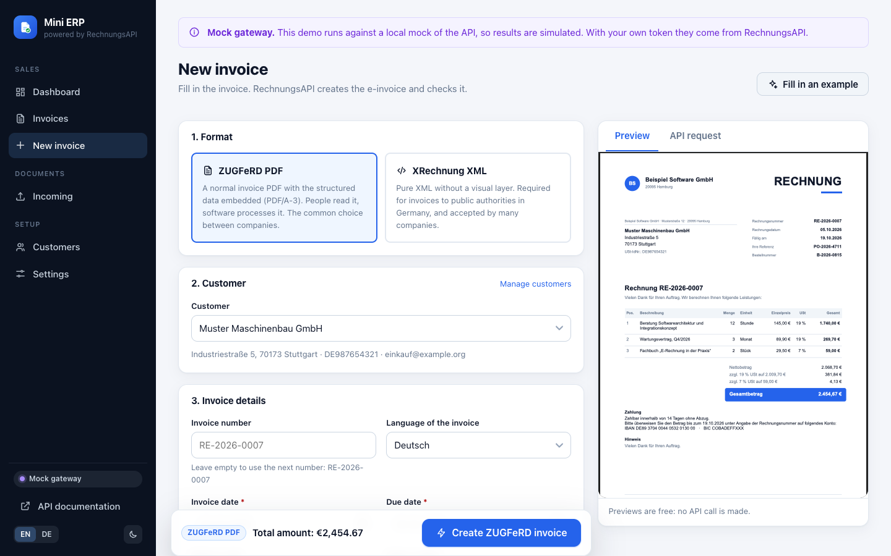
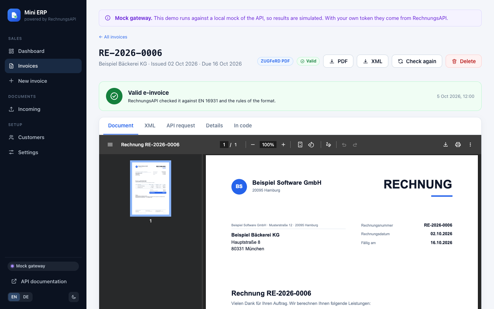
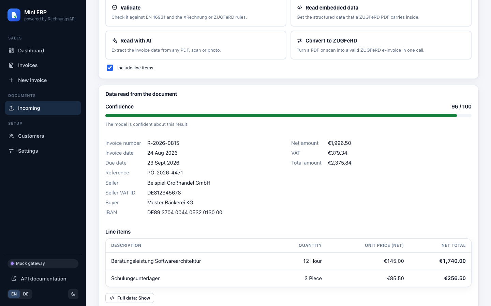
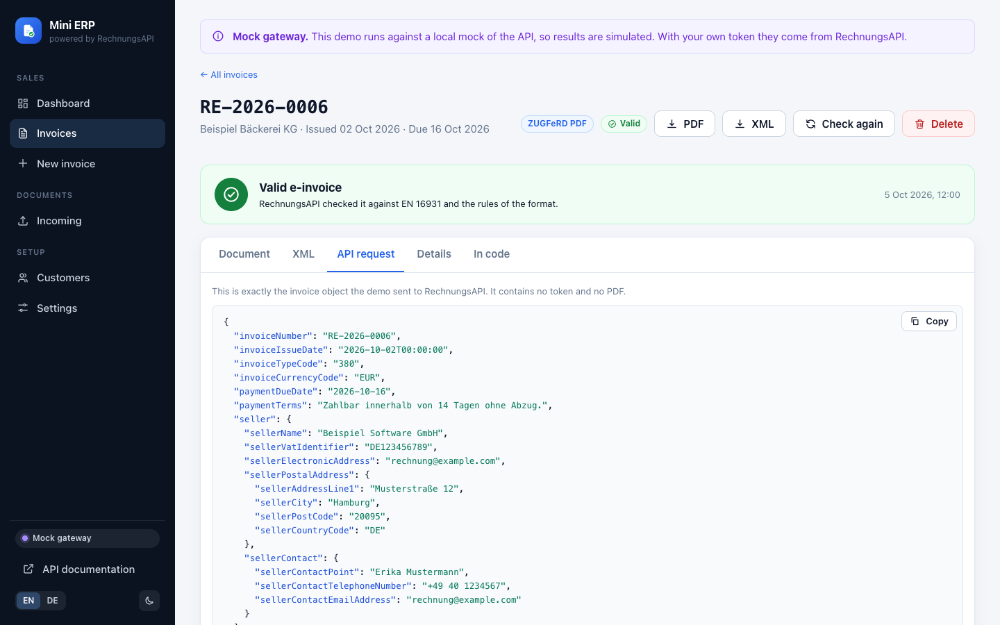
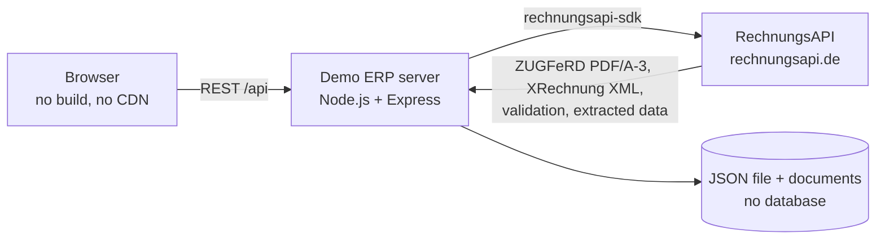

<p align="center">
  <a href="https://rechnungsapi.de"></a>
</p>

<p align="center">
  <a href="https://github.com/Rechnungsapi/rechnungsapi-erp-demo/actions/workflows/ci.yml"></a>
  <a href="https://www.npmjs.com/package/rechnungsapi-sdk"></a>
  
  
  
  <a href="LICENSE"></a>
</p>

<h1 align="center">rechnungsapi-erp-demo</h1>

<p align="center">
  <b>See what e-invoicing looks like inside an ERP.</b><br>
  An open-source demo that creates, checks and reads ZUGFeRD and XRechnung invoices with <a href="https://rechnungsapi.de">RechnungsAPI</a>.
</p>

Germany's e-invoicing obligation (E-Rechnungspflicht) is being phased in, and ERP and accounting software has to be able to send and receive structured invoices. **RechnungsAPI** is the REST API that takes care of the hard parts. This Mini ERP shows how little it takes to build it in: customers, invoices, a validation of everything you receive, and a clean integration you can read in one sitting and copy into your own system.

**[Start free](https://rechnungsapi.de/register)** · [Documentation](https://rechnungsapi.de/api-docs) · [SDK](https://github.com/Rechnungsapi/rechnungsapi-sdk) · [MCP server](https://github.com/Rechnungsapi/rechnungsapi-mcp) · [Pricing](https://rechnungsapi.de/pricing)

## See it

<table>
  <tr>
    <td width="50%"><a href="docs/screenshots/new-invoice.png"></a><br><sub><b>Create.</b> A live preview of the invoice, free of charge, while you type.</sub></td>
    <td width="50%"><a href="docs/screenshots/invoice-detail.png"></a><br><sub><b>Check.</b> Every invoice comes back validated, with the document, the XML and the findings.</sub></td>
  </tr>
  <tr>
    <td width="50%"><a href="docs/screenshots/incoming-read.png"></a><br><sub><b>Read.</b> Extract the data of any PDF, scan or photo, with a confidence score.</sub></td>
    <td width="50%"><a href="docs/screenshots/api-request.png"></a><br><sub><b>Understand.</b> The exact request that was sent: no token, no magic.</sub></td>
  </tr>
</table>

<sub>The screenshots show sample data and the built-in mock gateway (`npm run dev:mock`), which simulates the API so you can look around without a token. With your token, the documents and the validation come from RechnungsAPI.</sub>

## What it shows

| | |
|---|---|
| **Create** | Turn invoice data into a ZUGFeRD PDF/A-3 or an XRechnung XML. The demo draws the visual invoice itself, RechnungsAPI embeds the structured data. |
| **Validate** | Check XRechnung XML and ZUGFeRD PDFs against EN 16931 and the format rules, with the rule that failed and where. |
| **Read** | Extract structured data from PDFs, scans and photos with AI, including line items and a confidence score. |
| **Convert** | Turn a PDF or a scan into a valid ZUGFeRD e-invoice in one call. |
| **Send** | Generate an invoice and e-mail it in the same API call (needs e-mail delivery enabled for your account). |

Around that sits what makes it feel like an ERP: customers, automatic gap-free invoice numbers, a dashboard, a log of the API calls under the hood, English and German, light and dark.

## Run it in two minutes

You need [Node.js](https://nodejs.org) 22.12 or newer and a free API token: [create an account](https://rechnungsapi.de/register), open **Profile** and copy the token.

```bash
git clone https://github.com/Rechnungsapi/rechnungsapi-erp-demo.git
cd rechnungsapi-erp-demo
npm install
cp .env.example .env     # then paste your token into .env as RECHNUNGSAPI_TOKEN
npm start
```

Open **http://localhost:3000**. Prefer Docker? `docker compose up` does the same (it reads the token from `.env`).

Just want to look around first? `npm run dev:mock` starts the demo against a local mock of the API, no token needed. Its answers are simulated.

## The whole integration is one file

Every call to RechnungsAPI lives in [`server/einvoice.js`](server/einvoice.js), about 200 lines with comments. It uses the official [`rechnungsapi-sdk`](https://github.com/Rechnungsapi/rechnungsapi-sdk), hides the HTTP details, and turns every failure into a stable error code. The rest of the app never sees a status code, a field name from the API or your token.

```js
// server/einvoice.js (excerpt)
export function createEInvoice({ token, baseUrl, v2BaseUrl, fetch: fetchImpl, onCall = () => {} }) {
  const client = token ? new RechnungsApiClient({ apiToken: token, baseUrl, v2BaseUrl, fetch: fetchImpl }) : null
  // ...
  return {
    /** Checks an XRechnung XML against EN 16931 and the XRechnung rules. */
    validateXml: (xml) =>
      call("validateXRechnungXml", async (api) => {
        const result = await api.validateXRechnungXml(xml)
        return { valid: result.isValid, issues: issuesOf(result.messages), message: result.message }
      }),

    /** Reads any invoice (PDF, scan, photo) with AI and returns structured data. */
    read: (file, { withLineItems = true } = {}) =>
      call("analyzePdfInvoiceV2", async (api) => {
        const raw = await api.analyzePdfInvoiceV2(file.toString("base64"), withLineItems)
        return { confidence: raw.extractionConfidence, invoice: raw.invoice ?? {} }
      }),
  }
}
```

The other half of an integration is mapping your invoice to the EN 16931 invoice object. That is [`server/domain/to-api.js`](server/domain/to-api.js): one function, field by field, with a comment on every rule that is easy to trip over. How to adapt both to your own ERP is in [docs/CUSTOMIZING.md](docs/CUSTOMIZING.md).

## How it works



- **One process, no build.** Express serves the API and the UI. The UI is plain ES modules with a small vendored library, so `npm start` is all there is.
- **No database.** Invoices, customers and the generated files are plain JSON and files in `data/`, written atomically.
- **Totals you can trust.** Amounts are summed in cents and VAT is rounded once per VAT group, as EN 16931 requires. The same module runs in the browser and on the server, so the live form and the invoice cannot disagree.
- **Numbers without gaps.** An invoice number is only used up after the API accepted the invoice.

More in [docs/ARCHITECTURE.md](docs/ARCHITECTURE.md).

## Why RechnungsAPI

- **One API for the formats that matter.** ZUGFeRD, XRechnung and Factur-X compliant.
- **Compliance built in.** Built for EN 16931, GoBD and GDPR, with data processed on German servers.
- **Works with what you have.** A plain REST API with a typed SDK, so it fits ERP systems and custom software alike.
- **Developer first.** Documentation in English and German, an [MCP server](https://github.com/Rechnungsapi/rechnungsapi-mcp) for AI assistants, and an integration assistant on [rechnungsapi.de](https://rechnungsapi.de) that maps your fields and writes code stubs.
- **Free to start.** Try it without a credit card.

## Good to know

This is a **demo**, built to be read and copied, not a finished ERP. It has no login, no payment tracking and no multi-user support. So that it stays safe on your machine:

- It listens on `127.0.0.1` only. Don't expose it to the internet: anyone who can reach it can create invoices with your token.
- Your token lives in `.env` (which git ignores) and is only ever used on the server. The browser never sees it, and neither do the logs.
- It answers only to `localhost` host names and refuses requests that come from other websites.
- It loads nothing from the internet and sends a strict content security policy.

Details and how to report a problem: [SECURITY.md](SECURITY.md).

## Project layout

```
server/            Express app, the RechnungsAPI integration (einvoice.js), invoice PDF, storage
shared/            Money, VAT and date logic used by both the server and the browser
public/            The UI: plain ES modules, one stylesheet, one vendored library
scripts/           dev:mock (run against the mock gateway), demo:seed, vendor
test/              the test suite, with a mock gateway that applies the EN 16931 arithmetic rules
docs/              Architecture, adapting it to your ERP, screenshots
```

## Development

```bash
npm test             # the whole suite
npm run typecheck    # JSDoc types, checked by tsc, no build step
npm run dev:mock     # the demo against a local mock of the API
npm run demo:seed    # fill a running demo with six sample invoices
```

The mock gateway in [`test/mock-gateway.js`](test/mock-gateway.js) answers like the documented API and checks the EN 16931 arithmetic, so the tests prove that the invoice this demo builds would pass a validator. Its documents are simplified placeholders: real XML, PDF/A-3 and validation come from RechnungsAPI.

## Related

- [`rechnungsapi-sdk`](https://github.com/Rechnungsapi/rechnungsapi-sdk): the TypeScript/JavaScript SDK this demo uses.
- [`rechnungsapi-mcp`](https://github.com/Rechnungsapi/rechnungsapi-mcp): let your AI assistant create, validate and read e-invoices.
- [API documentation](https://rechnungsapi.de/api-docs): every endpoint, request, response and error code.

## Questions or a project in mind?

[Talk to us](https://rechnungsapi.de/contact) or write to support@rechnungsapi.de. RechnungsAPI is free to start, with no credit card required: [create your account](https://rechnungsapi.de/register).

## License

MIT © RechnungsAPI · [rechnungsapi.de](https://rechnungsapi.de) · support@rechnungsapi.de
