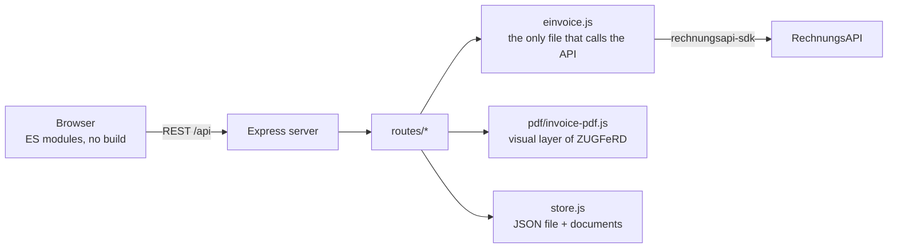

# Architecture

The demo is one Node.js process. Express serves the API under `/api` and the UI from `public/`. Everything that talks to [RechnungsAPI](https://rechnungsapi.de) goes through the official SDK, in one file.

## Creating an invoice, step by step

1. The form posts the draft to `POST /api/invoices` ([`routes/invoices.js`](../server/routes/invoices.js)).
2. [`domain/validate.js`](../server/domain/validate.js) checks every field and answers `422` with one stable code per field if something is wrong. Nothing else runs before that.
3. The totals are computed by [`shared/money.js`](../shared/money.js), the same module the browser used for the live form.
4. [`domain/to-api.js`](../server/domain/to-api.js) maps the invoice to the EN 16931 invoice object.
5. For a ZUGFeRD invoice, [`pdf/invoice-pdf.js`](../server/pdf/invoice-pdf.js) draws the visual PDF that the API will embed the XML into.
6. [`einvoice.js`](../server/einvoice.js) sends it with `createZugferdFromJson` (or `createXRechnungFromJson`) and turns the answer into `{ valid, issues, pdf, xml }`.
7. The documents and the record are stored, and only now is the invoice number used up.

Creating invoices is serialized, so two requests at the same moment cannot take the same number. A failed API call stores nothing and costs no number.

## Where things live

| Path | What it does |
|---|---|
| `server/einvoice.js` | The RechnungsAPI integration. SDK calls, result normalization, error mapping. |
| `server/domain/to-api.js` | Your invoice to the EN 16931 invoice object. The file to adapt for your ERP. |
| `server/domain/validate.js` | Strict parsing of everything the browser sends. |
| `server/domain/files.js` | Decodes uploads and recognises them by content. |
| `server/pdf/` | The invoice layout, in German and English. |
| `server/store.js` | One JSON file and a folder of documents, written atomically. |
| `server/security.js` | Host and origin checks, response headers. |
| `shared/` | Money, VAT, dates and IBAN checks that run in the browser and on the server. |
| `public/js/` | The UI. `main.js` is the shell, `pages/` has one module per screen. |

## Data

`data/db.json` holds the settings, customers, invoices, the history of incoming documents and the latest API calls. `data/files/` holds the generated PDFs and XML files. A file is named by a random id and is only ever opened through an id the server created, so a path from a URL can never point outside that folder.

An invoice keeps its own copy of the seller and the buyer, so changing a customer later never changes an invoice you already issued.

## Errors

The browser sees one error shape: `{ "error": "<code>", "message": "..." }`. The UI translates the code.

| Code | Status | Meaning |
|---|---|---|
| `validation` | 422 | A field is missing or wrong. `fields` names each one. |
| `seller_incomplete`, `customer_incomplete` | 409 | Data that an XRechnung needs is missing. `missing` lists it. |
| `number_taken` | 409 | The invoice number is already used. |
| `no_token` | 503 | No `RECHNUNGSAPI_TOKEN` is configured. |
| `unauthorized` | 502 | RechnungsAPI did not accept the token. |
| `no_access` | 402 | The plan does not include this, or the quota is used up. |
| `missing_fields` | 422 | RechnungsAPI wants more invoice data. `missing` lists the business terms. |
| `rate_limited`, `conflict` | 429, 409 | RechnungsAPI answered with these. |
| `timeout`, `unreachable`, `upstream` | 504, 502, 502 | RechnungsAPI did not answer in time, could not be reached, or failed. |
| `file_too_large`, `payload_too_large`, `unsupported_file` | 413, 413, 415 | The upload is too big or not a supported kind. |

A conversion that RechnungsAPI refuses (`createZugferdFromPdf`) is not an error: it is an answer with a reason, so it comes back as a normal result with `ok: false` and the rules involved.

## Security

The demo has no login, so it is built to stay on your machine:

- It binds to `127.0.0.1` unless you set `HOST`.
- The `Host` header must be a localhost name (add others with `ALLOWED_HOSTS`), which stops DNS rebinding. A state-changing request that carries an `Origin` header must come from the demo's own page. There is no CORS header.
- Every page and answer carries a content security policy without `unsafe-inline` or `unsafe-eval`. Stored PDFs are served with only a `frame-ancestors` rule, because the built-in PDF viewer needs that.
- The token is read from the environment once, at start. It is never sent to the browser, stored in the data folder or written to a log. The activity log keeps the SDK method, the outcome and the duration, nothing else.
- Uploads are recognised by their first bytes, never by file name or content type, and limited to 10 MB.
- The UI never builds HTML from strings: it renders through a library that escapes text, and a test forbids `innerHTML`.

## Tests

`npm test` runs the whole suite against the real server and a mock gateway:

- **Contract test.** The invoice object the demo sends may only use field names that the API documents. A typo fails the test.
- **Arithmetic test.** The mock gateway applies the EN 16931 rules for sums and VAT (`BR-CO-10` to `BR-CO-17`, plus a few more). Forty random invoices go through the whole stack and must all pass.
- **Failure tests.** Every way RechnungsAPI can fail is simulated and mapped to its code.
- **UI tests.** No external URLs, no inline scripts or styles, equal English and German texts, every module the browser imports is served.

The mock's documents are placeholders. It proves that the demo builds consistent invoices, not that a document is compliant: that is what RechnungsAPI is for.
